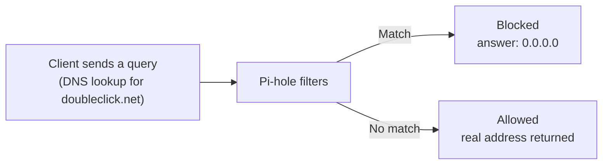

# How to install Pi-hole on a Raspberry Pi

**Network-wide ad and tracker blocking in 10 steps: Raspberry Pi 5 + Raspberry Pi OS Trixie.**


-A81D33?logo=debian&logoColor=white)


A step-by-step beginner guide that goes with the video lesson. No Linux experience needed: every step ends with a **"You should see"** check, so you know it worked before moving on.

---

## Contents

- [What you'll build](#what-youll-build)
- [Words to know](#words-to-know)
- [What you need](#what-you-need)
- [Plan your time](#plan-your-time)
- [How to read the code blocks](#how-to-read-the-code-blocks)
- [Step 1: Flash Raspberry Pi OS to the microSD card](#step-1-flash-raspberry-pi-os-to-the-microsd-card)
- [Step 2: Start the Pi and find its address](#step-2-start-the-pi-and-find-its-address)
- [Step 3: Connect to the Pi with SSH](#step-3-connect-to-the-pi-with-ssh)
- [Step 4: Check it's Trixie, then update](#step-4-check-its-trixie-then-update)
- [Step 5: Make the Pi's address permanent](#step-5-make-the-pis-address-permanent)
- [Step 6: Install Pi-hole with one command](#step-6-install-pi-hole-with-one-command)
- [Step 7: Answer the installer's questions](#step-7-answer-the-installers-questions)
- [Step 8: Set your password and sign in](#step-8-set-your-password-and-sign-in)
- [Step 9: Send your devices through Pi-hole](#step-9-send-your-devices-through-pi-hole)
- [Step 10: Test it — is it blocking?](#step-10-test-it--is-it-blocking)
- [If something goes wrong](#if-something-goes-wrong)
- [Commands to remember](#commands-to-remember)
- [Next challenges](#next-challenges)
- [Resources](#resources)

---

## What you'll build

Every device on your network sends a **DNS query** (like "where is google.com?") before it loads anything. Pi-hole is a small DNS server that checks each query against a blocklist:



- **Match: blocked.** The ad or tracker server never loads.
- **No match: allowed.** Pi-hole asks an upstream DNS service (like Cloudflare) and returns the real address.

> **A note on names.** In this guide the Raspberry Pi's hostname is **`rpi5`**, so it's never mixed up with **Pi-hole**, the software. The `pihole` commands (like `pihole status`) and the `pi.hole` web address belong to the software and don't change.

---

## Words to know

| Word | Meaning |
|---|---|
| **DNS** | The internet's phone book: turns names into numbers. |
| **IP address** | A device's number on the network, like `192.168.1.50`. |
| **Router** | The box that runs your home network and Wi-Fi. |
| **Terminal** | A text-only window: you type a command, press Enter, and the computer does it. |
| **SSH** | Secure Shell: control the Pi's command line from your own computer. |
| **sudo** | "Do this as the admin." It may ask for your password. |

> The terminal is the window; inside it runs a **shell** called **bash**, which actually runs your commands. SSH gives you the Pi's shell inside your own terminal.

---

## What you need

| Part | Notes |
|---|---|
| **Raspberry Pi 5** | 2 GB RAM or more (sold as 1, 2, 4, 8 or 16 GB) |
| **27 W USB-C power supply** | The official one |
| **microSD card** | 32 GB or larger |
| **Ethernet or Wi-Fi** | A cable is the most reliable |
| **Case with a fan** | Or the Active Cooler |
| **A computer** | With an SD card reader |

> **Ask first:** only change the settings on a router you own or have permission to change.
>
> **Tech note:** the Pi 5's RAM is LPDDR4X SDRAM, soldered to the board, so pick your size when you buy. RAM is the Pi's working memory; the microSD card is its storage. Pi-hole itself needs as little as 512 MB.

---

## Plan your time

| Step | Task | Typical time |
|---|---|---|
| 1 | Flash the SD card (download + write) | 5–15 min |
| 2 | First boot and find the Pi's IP | 3–5 min |
| 3 | Connect with SSH | 2–5 min |
| 4 | Check Trixie and run updates | 5–15 min |
| 5 | Make the IP address permanent | 5 min |
| 6–7 | Install Pi-hole and answer the questions | 5–10 min |
| 8 | Set the password and sign in | 2–3 min |
| 9 | Point your devices at Pi-hole | 5 min |
| 10 | Test that it's blocking | 2–5 min |
| **All** | **Total** | **35–65 min (about 1 hour)** |

Pi-hole itself takes only 15–20 minutes. Most of the time goes into writing the OS and the first updates.

> **Save time:** pre-flash the SD card with Raspberry Pi Imager (step 1) before you start, and once the Pi is on, run the updates:
>
> ```bash
> sudo apt update
> sudo apt full-upgrade
> ```

---

## How to read the code blocks

- Type only the commands. In this README the commands are shown **without** the `$` prompt.
- Anything after **`#`** is a comment. It won't run, so you don't need to type it.
- Anything in angle brackets is a placeholder. Replace the whole thing, **brackets included**, with your own value. For example, `<your_username>` becomes `alex`.
- `192.168.1.50` is an example address. Use **your** Pi's address everywhere you see it.

---

## Step 1: Flash Raspberry Pi OS to the microSD card

On your computer, install and open **[Raspberry Pi Imager](https://www.raspberrypi.com/software/)**. Then choose:

| Setting | Pick this |
|---|---|
| Device | Raspberry Pi 5 |
| Operating system | **Raspberry Pi OS (64-bit)**, the recommended one |
| Hostname | `rpi5` |
| Username | your choice: this is **`<your_username>`** |
| Password | a **STRONG** one you'll remember |
| Remote access | **Turn on SSH** (use password) |
| Wi-Fi | network name + password (skip if using a cable) |

- **Network name?** Imager often fills it in for you. If not, it's the Wi-Fi name on your phone or your router's sticker.
- **Why the desktop?** A familiar screen, mouse and browser. Built on Debian 13, nicknamed **Trixie**. Prefer terminal-only? Pick **Lite** under "Raspberry Pi OS (other)".
- **Strong password:** at least 12 characters, or a passphrase of three or four random words. This Pi accepts SSH logins from your whole network.

✅ **You should see:** "Write successful." Eject the card.

---

## Step 2: Start the Pi and find its address

1. **Plug it in.** SD card in, Ethernet to the router (skip if using Wi-Fi), then power **last**.
2. **Wait 2 minutes.** The first start sets things up and may reboot once.
3. **Find its IP.** Log in to your router and look for **`rpi5`** in the device list.

**No router access? Two ways in:**

1. **By name:** `ssh <your_username>@rpi5.local` works without the IP.
2. **On the Pi:** plug in a monitor and open Terminal on the desktop.

Then show the IP address:

```bash
# On the Pi (SSH or desktop)
hostname -I

# Or from your computer (press Ctrl+C to stop)
ping rpi5.local
```

> On current Raspberry Pi OS, the older `ifconfig` command is often not installed, so `hostname -I` is the reliable choice. Write your IP address down: you'll use it many times.

---

## Step 3: Connect to the Pi with SSH

Open a terminal on your computer:

- **Windows:** PowerShell
- **Mac:** Terminal
- **Linux:** Terminal

Type this **on your computer**, swapping in your username and your Pi's IP:

```bash
ssh <your_username>@192.168.1.50
# First time only: type yes
# Then type your password
# (nothing shows as you type!)
```

✅ **You should see:** `<your_username>@rpi5:~ $`. You're now typing on the Pi. To leave later, type `exit`.

---

## Step 4: Check it's Trixie, then update

Type this **on the Pi**:

```bash
# Which version am I running?
grep CODENAME /etc/os-release
# → VERSION_CODENAME=trixie

# Download and install updates
sudo apt update
sudo apt full-upgrade -y

# Restart, wait a minute, SSH back in
sudo reboot
```

**What's apt?** The Pi's app store. `update` checks what's new; `full-upgrade` installs it.

✅ **You should see:** `trixie` in the first answer. Updates can take 5–10 minutes.

> If it says `bookworm`, you flashed an older image. It will still work, but re-flashing with the latest Imager is easiest. Tip: press the **up arrow** to bring back a previous command.

---

## Step 5: Make the Pi's address permanent

Every device on your network will look for your Pi at this address. If it changes, the internet stops working.

**Easiest: use the router.** Find **`rpi5`** in the device list and choose "reserve IP" or "always use this address."

> The Pi's Wi-Fi and Ethernet have different hardware (MAC) addresses, so it may appear twice. Reserve the entry for the connection it uses now.

**No router access? Set it on the Pi instead.** Raspberry Pi OS Trixie uses NetworkManager:

```bash
# 1. Find your connection's NAME
nmcli con show

# 2. Open the menu tool (arrow keys to move, Enter to select)
sudo nmtui

# Edit the one you use: wired or Wi-Fi
#   IPv4:     Manual
#   Address:  192.168.1.50/24
#   Gateway:  your router's IP (often 192.168.1.1)
#   DNS:      1.1.1.1 (or your router's IP)
#   OK → Back → Quit, then reboot
sudo reboot
```

> In the `nmcli con show` list, the **TYPE** column says `ethernet` or `wifi`, and **DEVICE** shows `eth0` or `wlan0` for the active one. **Fill in the DNS field.** If it's empty, the Pi can't look up `install.pi-hole.net` and step 6 fails. After rebooting, SSH in again on that address.

---

## Step 6: Install Pi-hole with one command

Type this **on the Pi**, exactly as shown:

```bash
curl -sSL https://install.pi-hole.net | bash
```

| Part | What it does |
|---|---|
| `curl` | downloads the installer |
| `\|` | the "pipe" passes it along |
| `bash` | runs it |

Flags: `-s` silent, `-S` still shows errors, `-L` follows redirects. The pipe key is usually **Shift + \\**.

**Or look first: download it, read it, then run it.**

```bash
curl -sSL https://install.pi-hole.net -o basic-install.sh
less basic-install.sh      # read it; press q to quit
sudo bash basic-install.sh
```

Both ways install exactly the same thing.

> **Is this safe?** Yes. The source is official, the connection is encrypted (https), and it's been used for millions of installs over about ten years. The code is open source at [github.com/pi-hole/pi-hole](https://github.com/pi-hole/pi-hole).
>
> General rule: only pipe to `bash` from a project's official site, check the address carefully (look-alike domains are a common trick), and make sure it starts with `https`.

---

## Step 7: Answer the installer's questions

Use the **arrow keys** to move, **Space** to pick, **Enter** to continue. The mouse doesn't work here.

| Question | Choose | Why |
|---|---|---|
| Network interface | `eth0` or `wlan0` | `eth0` = cable, `wlan0` = Wi-Fi. On the RPi Private Router, pick `wlan1` (the access point) |
| Upstream DNS | Cloudflare or Quad9 | Answers the allowed lookups |
| Blocklist | Yes | A good starter list of ad sites |
| Query logging | Yes | Fills the dashboard graphs |
| Privacy mode | Show everything | Best for learning |

✅ **Last screen:** write down the **admin password** it shows. You need it next.

---

## Step 8: Set your password and sign in

```bash
# optional: choose your own password
sudo pihole setpassword
```

1. In a web browser, go to **`http://192.168.1.50/admin`** (your Pi's IP).
2. Type the password. There's **no username**.
3. Click **Log in**.

✅ **You should see:** the Pi-hole dashboard with graphs. Numbers stay low until step 9.

> `https://pi.hole/admin` only works once your device uses Pi-hole for DNS (step 9), so use the IP address for now. If you use `https`, the browser warns about the certificate because Pi-hole makes its own; on your home network it's safe to continue.

---

## Step 9: Send your devices through Pi-hole

**Option A: Safest start (just one device).**
In your laptop's network settings, set DNS to `192.168.1.50`. Only that laptop uses Pi-hole. Easy to undo: switch DNS back to automatic.

- **Windows:** Settings → Network → your connection → DNS server assignment
- **Mac:** System Settings → Network → Details → DNS

**Option B: Whole home (the router).**
In the router's DHCP or LAN settings, set the DNS server to `192.168.1.50`. Leave the second DNS box **empty**, then reconnect each device.

> ⚠️ Only change a router you own or have permission to change. If the Pi is off, devices using it can't load websites. Don't add a backup DNS like `8.8.8.8`: devices will use it and skip Pi-hole.

**Option C: On the RPi Private Router (the Pi is the router).**
Your Pi already hands out addresses on `wlan1` with dnsmasq, so tell that DHCP server to give clients the Pi as their DNS. In your dnsmasq config, add:

```ini
# dnsmasq does DHCP only; Pi-hole answers DNS
port=0
# hand out the Pi's wlan1 address as DNS, e.g. 192.168.50.1
dhcp-option=option:dns-server,<pi-wlan1-ip>
```

Then `sudo systemctl restart dnsmasq` and reconnect a device to the private Wi-Fi.

> ⚠️ **Why `port=0`?** Pi-hole has its own built-in copy of dnsmasq. If your standalone dnsmasq also listens on port 53, the two fight over it and Pi-hole fails to start. Check the winner with `sudo ss -lunp | grep ':53 '`: it should say `pihole-FTL`.

---

## Step 10: Test it — is it blocking?

Type this **on your computer**:

```bash
# Ask Pi-hole about an ad site
nslookup doubleclick.net 192.168.1.50
# Look for: Address: 0.0.0.0

# Ask about a normal site
nslookup raspberrypi.com 192.168.1.50
# Look for: a real address
```

**Checklist**

- [ ] Ad site gives `0.0.0.0`
- [ ] Normal sites still load
- [ ] Dashboard counts go up
- [ ] Query Log shows "Blocked"

🎉 Well done, you have a working network-wide ad blocker!

---

## If something goes wrong

| Problem | Try this |
|---|---|
| SSH says "connection refused" | Wait 2 more minutes. Check SSH was turned on in Imager. |
| Password not accepted | Typing is invisible. Retype slowly; check Caps Lock. |
| `pi.hole/admin` won't open | Use `http://<pi-ip>/admin` instead. |
| A website stopped working | Query Log → find the blocked name → **Allow** it. |
| No websites load at all | Is the Pi on? Run `pihole status`. Undo step 9 while you fix it. |
| Ads still show | Remove any second DNS. Reconnect the device. |

> Some YouTube and in-app ads can't be blocked by DNS at all, and that's normal.

---

## Commands to remember

Run these on the Pi:

| Command | To |
|---|---|
| `sudo pihole status` | check it's running |
| `sudo pihole -up` | update Pi-hole |
| `sudo pihole setpassword` | change the password |
| `sudo pihole allow site.com` | unblock a site |

---

## Next challenges

- Add a second blocklist (dashboard → **Lists**)
- Explore the **Query Log** to see which devices talk to which sites
- Update once a month with `sudo pihole -up`

---

## Resources

- 📘 Pi-hole documentation: <https://docs.pi-hole.net/main/>
- 💻 Pi-hole source code: <https://github.com/pi-hole/pi-hole>
- 💿 Raspberry Pi Imager: <https://www.raspberrypi.com/software/> · <https://github.com/raspberrypi/rpi-imager>

---

*Written for Pi-hole v6 on Raspberry Pi OS Trixie (Debian 13), October 2026.*
