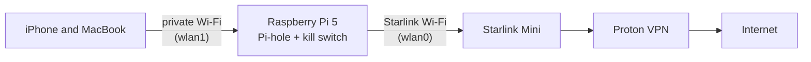

# Connecting to Starlink

Join the Raspberry Pi 5 travel router to your Starlink Mini's Wi-Fi, so Starlink becomes the Pi's upstream internet. Your private Wi-Fi, the WireGuard tunnel, the kill switch and Pi-hole don't change: the tunnel simply rides over Starlink instead of your home Wi-Fi.

> Part of the [RPi Private Router](../README.md) project. Do this after the [Travel VPN](../travel-vpn/README.md) is working at home. Build and test at home first, then switch the upstream to Starlink: if something breaks, you know it's the Starlink connection and not the router.

## How it fits together



- `wlan0` is the Pi's built-in Wi-Fi radio. It joins Starlink.
- `wlan1` is the Alfa adapter. It runs your private Wi-Fi.

## Before you start

- Run every command **on the Pi**: over SSH from a device on the private Wi-Fi, or with a keyboard and monitor plugged into the Pi. Switching `wlan0` to Starlink won't drop an SSH session on the private Wi-Fi.
- Power on the Starlink Mini and wait until the Starlink app shows it online.
- Know your Starlink **Wi-Fi network name** and password (see below).

## The two names in the Starlink app

| In the app | What it is | Does the Pi use it? |
|---|---|---|
| Big name at the top left, with "Mini" underneath | Your **subscription nickname**: it labels the dish in your account | ❌ No |
| Name next to the Wi-Fi icon, with "0 devices" | Your **Wi-Fi network name (SSID)** | ✅ Yes |

The Wi-Fi password is in the app's Wi-Fi settings.

## Profile name vs. Wi-Fi name

NetworkManager saves each network as a **connection profile**. A profile has two different names, and mixing them up is the most common mistake:

| Setting | What it is | Example | Used for |
|---|---|---|---|
| `con-name` | The **profile name**. You choose it. | `<You_Choose_A_Name>` | `nmcli con up`, `down`, `mod`, `delete` |
| `ssid` | The **Wi-Fi network name** from the Starlink app | `"<Your_Starlink_SSID>"` | Which network the profile joins |

So `sudo nmcli con up <You_Choose_A_Name>` means "use this profile", and the profile joins `<Your_Starlink_SSID>`. Running `nmcli con up` with the Wi-Fi name instead gives **`unknown connection`**, because no profile has that name.

Pick a short profile name with no spaces, such as `STARLINK`, and use it everywhere below.

## 1. Find your Starlink network

```bash
sudo nmcli dev wifi rescan ifname wlan0
nmcli dev wifi list ifname wlan0
```

- Look for the same Wi-Fi name you saw next to the Wi-Fi icon in the app.
- `rescan` needs `sudo`, or you get `not authorized`.
- Ignore rows that show `--`: those are hidden networks.
- Not listed? Move the Pi closer, or wait a minute for the dish to finish starting, then rescan.

## 2. Save the Starlink profile

The `read` line asks for the password without showing it on screen or saving it in your shell history.

```bash
read -rsp "Starlink Wi-Fi password: " PSK; echo

sudo nmcli con add type wifi \
  ifname wlan0 con-name <You_Choose_A_Name> \
  ssid "<Your_Starlink_SSID>" \
  wifi-sec.key-mgmt wpa-psk \
  wifi-sec.psk "$PSK" \
  connection.autoconnect yes \
  connection.autoconnect-priority 10

unset PSK
```

- The `nmcli con add` command is **one command over seven lines**. The `\` at the end of each line tells the shell to keep reading, so copy and paste all seven together.
- Replace both placeholders and don't type the `< >`. The Wi-Fi name is case-sensitive; keep the quotes if it has spaces.
- `wifi-sec.key-mgmt wpa-psk` must be set, or nmcli refuses the profile.
- `autoconnect-priority 10` makes the Pi prefer Starlink over your home Wi-Fi (priority 0) when both are in range.
- You can do this at home before a trip: it only saves the network.
- `unset PSK` clears the password from the shell.

## 3. Connect and confirm

```bash
sudo nmcli con up <You_Choose_A_Name>
nmcli dev status | grep wlan0                      # connected  <You_Choose_A_Name>
iw dev wlan0 info | grep ssid                      # ssid <Your_Starlink_SSID>
ip -br a show wlan0                                # an address handed out by the Starlink router
nmcli -f NAME,AUTOCONNECT-PRIORITY con show        # Starlink at 10, home Wi-Fi at 0
```

The Starlink app should now show **1 device**. That device is the Pi; your phone and laptop stay hidden behind it.

## 4. Check the tunnel

```bash
sudo travel-vpn status
sudo travel-vpn check
```

You want three good results:

| Result | Meaning |
|---|---|
| **Tunnel: UP** | The WireGuard tunnel (`wg0`) has had a recent handshake with your VPN server |
| **Kill switch: ON** | If the tunnel drops, traffic stops instead of leaking over Starlink |
| **Public IPv4** belongs to your VPN | Websites see the VPN's address, not Starlink's |

Double-check from your phone or laptop on the private Wi-Fi by opening a what-is-my-IP site.

## Which Wi-Fi does the Pi pick?

| Profile | When | Priority |
|---|---|---|
| Starlink | On the road | 10 |
| Home Wi-Fi | When Starlink is off | 0 |

- Both in range: the Pi joins Starlink.
- Starlink off or packed away: the Pi joins your home Wi-Fi on its own. The VPN works the same either way.
- **Catch:** if the Pi is already on home Wi-Fi when you power up Starlink, it won't switch by itself. Priority decides which network to join, not whether to leave a working one. Run `sudo nmcli con up <You_Choose_A_Name>`, or reboot the Pi.

## Where the profile is stored

Each profile is a file in `/etc/NetworkManager/system-connections/`, readable only by root because it holds the Wi-Fi password.

```bash
nmcli -f NAME,TYPE,DEVICE con show                               # all saved profiles
sudo ls /etc/NetworkManager/system-connections/                   # their files
nmcli -g 802-11-wireless.ssid con show <You_Choose_A_Name>        # the Wi-Fi name it joins
sudo grep -v psk= /etc/NetworkManager/system-connections/<You_Choose_A_Name>.nmconnection   # settings, password hidden
```

## Troubleshooting

| What you see | Fix |
|---|---|
| `unknown connection` | You used the Wi-Fi name. Use the **profile name** (`con-name`) |
| Rescan says `not authorized` | Run it with `sudo` |
| `802-11-wireless-security.key-mgmt: property is missing` | Use `nmcli con add` with `wifi-sec.key-mgmt wpa-psk` (as above), not the `nmcli dev wifi connect` shortcut |
| "There are N other connections with the name ..." | Earlier attempts left copies. `nmcli con show` lists them; delete each with `sudo nmcli con delete uuid <UUID>`, then add one fresh profile |
| SSH from the Mac hangs | The Mac joined your home Wi-Fi. Turn off **Auto-Join** for it and rejoin the private Wi-Fi |
| "Host key changed" warning | Run `ssh-keygen -R <pi-address>` on the Mac, then connect again |
| Pi joined the wrong network | Check the priorities: Starlink 10, home Wi-Fi 0 |
| Names resolve but nothing loads, or `apt update` times out | The tunnel stopped passing traffic. Run `sudo systemctl restart wg-quick@wg0`, wait 15 seconds, then `sudo wg show wg0` should show a recent handshake |

> ⚠️ **Subnet clash.** Your private Wi-Fi on `wlan1` must use a different subnet from the one the Starlink router hands out, or the Pi can't tell them apart. `sudo travel-vpn check` tests this for you. Also make sure `nmcli dev status` shows `wlan1` as `unmanaged`, so NetworkManager leaves it to hostapd.
