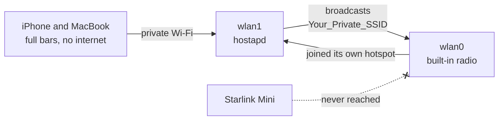

# When the router connects to itself: full Wi-Fi bars, no internet

A real troubleshooting story from this project. The iPhone and MacBook joined the private Wi-Fi with full bars, but nothing loaded. The cause: the Pi's built-in radio (`wlan0`) had joined **its own hotspot** instead of the Starlink Mini. The router was talking in a circle.

> Part of the [RPi Private Router](../README.md) project. It assumes the [Travel VPN](../travel-vpn/README.md) setup and [Connecting to Starlink](../connect-to-starlink/README.md).

Every network name here is a placeholder: `<Your_Private_SSID>` is your hotspot on `wlan1`, `<Your_Starlink_SSID>` is the Starlink Mini's Wi-Fi, and `STARLINK` is the NetworkManager profile name for it. Use your own names.

## Contents

1. [How it should work](#1-how-it-should-work)
2. [The symptoms](#2-the-symptoms)
3. [What actually happened](#3-what-actually-happened)
4. [The good news: the kill switch did its job](#4-the-good-news-the-kill-switch-did-its-job)
5. [Find it: check each link in order](#5-find-it-check-each-link-in-order)
6. [Where the profile came from: hostapd vs. NetworkManager](#6-where-the-profile-came-from-hostapd-vs-networkmanager)
7. [Why it happened: a race at boot](#7-why-it-happened-a-race-at-boot)
8. [The fix](#8-the-fix)
9. [Keep it from coming back](#9-keep-it-from-coming-back)
10. [Quick reference](#quick-reference)

## 1. How it should work

Every packet goes through the Pi and the VPN:


Each part has one job:

| Part | Role | Job |
|---|---|---|
| `wlan1` (Alfa USB adapter) | The access point | Broadcasts `<Your_Private_SSID>` using **hostapd**. Your iPhone and MacBook join it. |
| `wlan0` (Pi's built-in radio) | The uplink | Should join `<Your_Starlink_SSID>`, the Starlink Mini's Wi-Fi, using **NetworkManager**. |
| `wg0` (WireGuard) | The tunnel | Carries everything through `wlan0` to Proton's VPN server. |
| nftables | The kill switch | Hotspot traffic may only leave through `wg0`. |

**Only the Pi should ever be connected to the Starlink Wi-Fi. Your devices only join the private Wi-Fi.**

## 2. The symptoms

| Where the device was | What happened |
|---|---|
| On `<Your_Private_SSID>` | **Connected, but dead.** Full bars on the iPhone and MacBook, but no websites and no apps. The iPhone said "No Internet Connection." |
| On `<Your_Starlink_SSID>` directly | **Online, but unprotected.** It works, but it skips the Pi: no VPN, no Pi-hole and no kill switch. That's exactly what this router exists to prevent. |

Every device failed the same way, so the problem was in the router, not the iPhone.

## 3. What actually happened

The uplink radio joined my own hotspot:



`wlan0` → `wlan1` → back to `wlan0`. With no road out to Starlink, nothing could reach the internet.

## 4. The good news: the kill switch did its job

With no upstream connection, the WireGuard tunnel (`wg0`) couldn't reach Proton's VPN server. The kill switch saw no tunnel and blocked everything: **no internet, instead of unprotected internet.**

- `forward` chain → policy `drop`. With no tunnel, nothing from the private Wi-Fi gets out. This is called **failing closed**, and it's the safe way to fail.
- `nftables.conf` loads at boot and the kernel enforces it. No tunnel, no exit.

So the kill switch wasn't the problem. The uplink was.

## 5. Find it: check each link in order

Don't guess. Start at the devices and work outward, one link at a time:

1. **Is it one device, or all of them?** Both failed, so the problem is the router.
2. **Can the Pi itself reach the internet?**
3. **What is `wlan0` actually connected to?**
4. **Why did it connect there?**

Run these **on the Pi**, over SSH from a device on the private Wi-Fi. SSH still works, because it only needs `wlan1`.

### Clue 1: the Pi couldn't even find a gateway

```bash
ping -c3 -I wlan0 1.1.1.1
```

| Part | Meaning |
|---|---|
| `ping` | "Hello, are you there?" |
| `-c3` | Send 3, then stop |
| `-I wlan0` | Go out the Starlink radio |
| `1.1.1.1` | A public internet server |

What I saw:

```
PING 1.1.1.1 (1.1.1.1) from 192.168.50.xxx wlan0: 56(84) bytes of data.
From 192.168.50.xxx icmp_seq=1 Destination Host Unreachable
3 packets transmitted, 0 received, +3 errors, 100% packet loss
```

- **"Unreachable" from my own address** means the problem is before the internet, and before the VPN.
- **Look at the address.** `wlan0` gets its address from whatever network it joined. A `192.168.50.x` address is from **your own private Wi-Fi's** range, not Starlink's (`192.168.1.x`). That's the giveaway.

### Clue 2: `wlan0` was connected to my own hotspot

This is the big one:

```bash
iw dev wlan0 link
```

```
Connected to 00:c0:ca:xx:xx:xx (on wlan0)
        SSID: <Your_Private_SSID>
        freq: 2437.0
        signal: -26 dBm
        rx bitrate: 65.0 MBit/s
```

- **SSID** should be `<Your_Starlink_SSID>`. It's your own hotspot.
- **-26 dBm** is about as strong as Wi-Fi gets: the Alfa adapter is inches away.
- **`00:c0:ca`** is Alfa's hardware address prefix. The access point `wlan0` joined is your own Alfa adapter.

> 💡 **Lesson:** check the simple links first. `iw dev wlan0 link` would have found this in five seconds.

### Clue 3: a saved profile told it to join

```bash
nmcli -f NAME,TYPE,DEVICE,AUTOCONNECT connection show
```

```
NAME                TYPE       DEVICE  AUTOCONNECT
<Your_Private_SSID> wifi       wlan0   yes
lo                  loopback   lo      no
wg0                 wireguard  wg0     no
STARLINK            wifi       --      yes
VENUE               wifi       --      yes
```

A **client profile for my own hotspot**, set to auto-connect, active on `wlan0`. Case solved.

## 6. Where the profile came from: hostapd vs. NetworkManager

**hostapd broadcasts. NetworkManager joins.** They are two separate tools, and they don't talk to each other.

| | hostapd | NetworkManager |
|---|---|---|
| Interface | `wlan1` (Alfa adapter) | `wlan0` (built-in radio) |
| Role | **The access point** | **The client** |
| What it does | Broadcasts `<Your_Private_SSID>` from `/etc/hostapd/hostapd.conf` | Joins networks, and saves every network the Pi joins as a **profile**, set to auto-connect |
| Saves profiles? | ❌ Never | ✅ Always, in `/etc/NetworkManager/system-connections/` |
| Sees the other's settings? | ❌ No | ❌ No. `wlan1` is `unmanaged`, so NetworkManager leaves it alone |

So hostapd didn't create the profile. NetworkManager did, because at some point the Pi **joined its own hotspot as a client**. The most likely way is testing the hotspot from the Pi itself: with `nmcli dev wifi connect`, `nmtui`, or the desktop Wi-Fi menu. A profile named exactly after the hotspot, set to auto-connect, is what any of those leave behind.

**If the Pi ever joins its own hotspot, even once, NetworkManager remembers it** and can rejoin it on its own later.

Want to see when and how yours appeared? These usually tell you:

```bash
sudo ls -l /etc/NetworkManager/system-connections/                # when each profile file was created
grep -n "<Your_Private_SSID>" ~/.bash_history                     # a past nmcli command, if you typed one
journalctl -u NetworkManager | grep -i "<Your_Private_SSID>"      # when it was added or used, if logs go back that far
```

## 7. Why it happened: a race at boot

| At power-up | Ready |
|---|---|
| Pi 5 + hotspot | In seconds, so the Pi is the first to look around |
| Starlink Mini | A minute or more |

When the Pi first looked, **the only network it could see was its own hotspot, and it had a saved profile for it.** So it joined. Once connected, it never switched away: NetworkManager's priority decides which network to join, not whether to leave one that's already working.

## 8. The fix

One command, plus two quick steps.

### Step 1: Delete the profile that caused the loop

Confirm the profile's name first. It's usually the hotspot's name:

```bash
nmcli -f NAME,UUID,DEVICE con show
nmcli -g 802-11-wireless.ssid con show "<Your_Private_SSID>"     # prints your private Wi-Fi name = this is the one
```

Then delete it:

```bash
sudo nmcli connection delete "<Your_Private_SSID>"
```

```
Connection '<Your_Private_SSID>' (…) successfully deleted.
```

- **Safe to delete.** Your real hotspot runs on hostapd, not NetworkManager. This is only the client profile. Your private Wi-Fi keeps broadcasting.
- `wlan0` drops off the hotspot right away. Your SSH session stays up through `wlan1`.
- Several profiles with the same name? Delete each by UUID: `sudo nmcli con delete uuid <UUID>`.

### Step 2: Put `wlan0` back on Starlink, priority 10

Make sure the Starlink Mini is on and the app shows it online, then:

```bash
sudo nmcli connection up STARLINK ifname wlan0
sudo nmcli connection modify STARLINK \
  connection.interface-name wlan0 \
  connection.autoconnect-priority 10
```

- `interface-name wlan0` locks the Starlink profile to the built-in radio.
- **Priority 10** means the Pi picks Starlink over any other saved network in range (they default to 0).
- If your Starlink profile has a different name, use that name instead of `STARLINK`.

Check that both settings stuck:

```bash
nmcli -g connection.interface-name,connection.autoconnect-priority \
  con show STARLINK
```

```
wlan0:10
```

`wlan0:10` means the Starlink profile is locked to `wlan0`, with priority 10. `-g` prints only the values you ask for, separated by `:`. No `sudo` needed: it only reads the profile.

### Step 3: Prove it works

```bash
iw dev wlan0 link | grep SSID         # SSID: <Your_Starlink_SSID>
ip route | grep default                # default via … dev wlan0
ping -c3 -I wlan0 1.1.1.1              # replies, 0% packet loss
sudo wg show | grep handshake          # latest handshake: seconds ago
sudo travel-vpn status                 # Tunnel UP, Kill switch ON, a VPN public IP
```

Then the real test: on your iPhone or MacBook on the private Wi-Fi, open `https://ipleak.net` or `https://ifconfig.me`. Internet is back, and it shows a **Proton IP, not Starlink's**.

## 9. Keep it from coming back

| | What to do | Why |
|---|---|---|
| **Habit** | Test the hotspot **from your phone**. Never join it from the Pi itself to check it works. | Joining it from the Pi is what creates the client profile. |
| **Setting** | Keep Starlink **pinned to `wlan0` with priority 10**, so it always wins. | Higher priority means it's chosen over any other saved network in range. |
| **Cleanup** | **Forget old networks.** Delete stale profiles, like last week's hotel `VENUE`. | Fewer saved networks means fewer wrong ones for the Pi to join. |

Check your saved profiles now and then. Your private Wi-Fi name should **never** appear in this list:

```bash
nmcli -f NAME,TYPE,AUTOCONNECT con show
```

The [startup checklist](../travel-vpn/STARTUP-CHECKLIST.md) also checks that `wlan0` is on your upstream network, not your own hotspot.

## Quick reference

| What you see | What it means | Fix |
|---|---|---|
| Full Wi-Fi bars, no internet on every device | The router can't get out, so the kill switch blocks everything | Work through [section 5](#5-find-it-check-each-link-in-order) |
| `ping -I wlan0` says `Destination Host Unreachable` from a `192.168.50.x` address | `wlan0` got an address from your own private Wi-Fi | `iw dev wlan0 link` to confirm |
| `iw dev wlan0 link` shows `<Your_Private_SSID>` | `wlan0` joined your own hotspot | [Step 1](#step-1-delete-the-profile-that-caused-the-loop) and [Step 2](#step-2-put-wlan0-back-on-starlink-priority-10) |
| A profile named after your private Wi-Fi in `nmcli con show` | NetworkManager saved your hotspot as a client network | `sudo nmcli con delete "<Your_Private_SSID>"` |
| Devices work only when joined to Starlink directly | They're skipping the Pi: no VPN, no kill switch | Rejoin the private Wi-Fi and fix the Pi instead |
