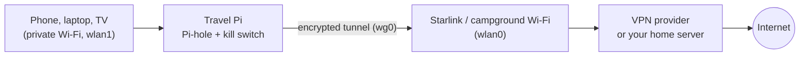

# Travel VPN: WireGuard client mode for the road (Starlink, campgrounds, hotels)

Turn the travel Pi into a VPN router: every device on your private Wi-Fi goes through an encrypted WireGuard tunnel, with Pi-hole still blocking ads. If the tunnel drops, a **kill switch** blocks traffic instead of letting it leak out unprotected.



> **Which WireGuard guide do I need?**
> - **This one** if the Pi travels with you, especially on Starlink. Starlink's Residential and Roam plans use CGNAT, so nothing on the internet can connect *in* to the Pi, but the Pi can connect *out* to a VPN.
> - **[Home server version](../wireguard/README.md)** if the Pi stays at home and you want your phone to connect back to it.

## What you get

- **Protection on public Wi-Fi.** Campground, hotel and café networks see only encrypted traffic, for every device at once, with no VPN app on each one.
- **Privacy from the network operator.** Starlink or the venue can't see which sites you visit.
- **Pi-hole everywhere.** Ad and tracker blocking keeps working, and its lookups also travel through the tunnel.
- **A kill switch.** If the tunnel drops, devices lose internet rather than going out unprotected.

## Defaults

| Setting | Value |
|---|---|
| Upstream (internet) | `wlan0`: Starlink router Wi-Fi, campground or hotel Wi-Fi |
| Private network | `wlan1`: the hostapd access point |
| Tunnel | `wg0` |

Check yours with `ip -br a`. If your upstream is different (for example `eth0` with Starlink's Ethernet adapter), change `WAN` at the top of **both** `nftables.conf` and `travel-vpn.sh`.

## Files

| File | What it does |
|---|---|
| `travel-vpn-setup.sh` | One-time setup from your WireGuard config file |
| `travel-vpn.sh` | Installed as the `travel-vpn` command: `on`, `off`, `status` |
| `nftables.conf` | Complete travel-router firewall with the kill switch |

---

## 1. Get a WireGuard config file

You need one **full-tunnel** WireGuard config (a `.conf` file). Two options:

**A. A VPN provider (simplest).** Mullvad, Proton VPN and many others let you download WireGuard configs from their website. Look for a "WireGuard configuration" or "router" download, pick a server near you, and choose IPv4 for the endpoint if asked. A config whose `Endpoint` is an IP address (not a hostname) is the most reliable at boot.

**B. Your own home server.** If you have a home internet connection **without** CGNAT, set up the [home server version](../wireguard/README.md) on a Pi at home, then make a config for the travel Pi:

```bash
# on the HOME Pi
sudo ./wg-add-client.sh travelpi yourname.duckdns.org
sudo cat /etc/wireguard/clients/travelpi.conf
```

Your devices then appear to be at home, which helps with banking and streaming sites that dislike unusual locations.

Copy the file to the travel Pi, for example from your computer:

```bash
scp mullvad-us-den.conf <your_username>@<travel-pi-ip>:~/
```

> Treat this file like a password: it contains your private key. Don't commit it to GitHub or share it.

## 2. Install the kill-switch firewall

`nftables.conf` here is a **complete** firewall for the travel router. Back up your current one and compare before replacing it:

```bash
sudo cp /etc/nftables.conf /etc/nftables.conf.bak
diff /etc/nftables.conf travel-vpn/nftables.conf     # see what changes
sudo cp travel-vpn/nftables.conf /etc/nftables.conf
sudo nft -c -f /etc/nftables.conf                    # syntax check, changes nothing
sudo systemctl restart nftables
```

Do this from a device on the private Wi-Fi or the Pi's own keyboard.

> ⚠️ **Right after this step, devices on the private Wi-Fi have no internet.** That's the kill switch doing its job: no tunnel yet, so no traffic. Step 3 fixes it.

**How the kill switch works:** the `forward` chain lets `wlan1` devices out through `wg0` only. Traffic heading straight out of `wlan0` jumps to the `direct_access` chain, which is empty, so it falls through to the `drop` policy. `travel-vpn off` adds a single `accept` there for captive-portal logins.

## 3. Run the setup

```bash
cd travel-vpn
sudo ./travel-vpn-setup.sh ~/mullvad-us-den.conf
```

The script:

1. Checks the config is a full tunnel (`AllowedIPs = 0.0.0.0/0`). Split-tunnel configs are refused, because the kill switch would block everything outside the tunnel.
2. Installs `wireguard-tools`.
3. Writes `/etc/wireguard/wg0.conf` (backing up any existing one) **without** the `DNS =` line, since Pi-hole handles DNS for the whole network.
4. Saves the provider's DNS server, which becomes **Pi-hole's upstream** while the tunnel is on. Those lookups travel inside the tunnel.
5. Installs the `travel-vpn` command, sets the tunnel to start at boot, and turns it on.

## 4. Everyday use

```bash
sudo travel-vpn status   # tunnel, kill switch, public IP
sudo travel-vpn on       # protected (the normal state, and after every reboot)
sudo travel-vpn off      # portal mode, for Wi-Fi login pages
```

### Wi-Fi with a login page (captive portal)

Campground and hotel Wi-Fi often needs you to accept terms on a web page first. The tunnel can't connect until you do, and the kill switch blocks the page, so:

1. Connect the Pi's `wlan0` to the venue's Wi-Fi as usual.
2. `sudo travel-vpn off`: the tunnel stops, devices go straight out, and Pi-hole uses the venue's DNS so the login page can appear.
3. On your phone (on the private Wi-Fi), open any `http://` site, such as `http://neverssl.com`, and complete the login page.
4. `sudo travel-vpn on`: back to protected.

> ⚠️ In portal mode, devices are **not protected**. Keep it short. A reboot or a firewall reload always turns the kill switch back on.

Starlink itself has no login page, so on Starlink you'll normally never need `off`.

## 5. Test it (the on-camera demo)

1. `sudo travel-vpn status`: tunnel UP with a recent handshake, kill switch ON, and the public IP is the VPN server's, not Starlink's.
2. On a phone on the private Wi-Fi, open `https://ifconfig.me`: same VPN IP.
3. Open an ad-heavy site: ads blocked, and Pi-hole's Query Log shows the phone's lookups.
4. **Kill-switch proof:** `sudo systemctl stop wg-quick@wg0`. The phone loses internet instead of falling back to Starlink. Then `sudo travel-vpn on` restores it.

## Troubleshooting

| Symptom | Likely cause | Check |
|---|---|---|
| No handshake | Venue blocks VPN traffic or has a login page; wrong or expired config | `sudo travel-vpn off`, log in, `on` again; try another server's config |
| Tunnel fails at boot | `Endpoint` is a hostname and DNS wasn't ready | Use a config with an IP endpoint |
| Handshake but devices have no internet | `wlan1 -> wg0` forward rule or `wg0` masquerade missing | `sudo nft list ruleset` |
| Websites by IP work, names don't | Pi-hole upstream not set or not reachable | `sudo pihole-FTL --config dns.upstreams` |
| Some sites hang or load partly | MTU too large on this link | Add `MTU = 1380` under `[Interface]` in `/etc/wireguard/wg0.conf`, then `sudo travel-vpn on` |
| Interfaces swapped after reboot | USB adapter came up as `wlan0` | `iw dev`; pin the Alfa's name to its MAC address |

## Good to know

- **The Pi's own lookups** (for example during `apt update`) use the upstream network's DNS server directly. That's what lets the tunnel find its endpoint at boot. Your devices' lookups always go through Pi-hole and the tunnel.
- **One WireGuard role per Pi.** This setup and the home server version both use `wg0`. Run the server on a Pi at home and this client on the travel Pi.
- **Switching servers:** download a new config and run `travel-vpn-setup.sh` again with it. The old `wg0.conf` is backed up first.
- **IPv6:** the kill switch only lets private-network traffic out through the tunnel, so IPv6 can't leak around it either.
