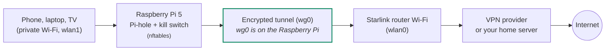

# Travel VPN: WireGuard client mode for the road (Starlink, campgrounds, hotels)

Turn a **Raspberry Pi 5** into a travel VPN router (the "travel Pi" in this guide): every device on your private Wi-Fi goes through an encrypted WireGuard tunnel, with Pi-hole still blocking ads. If the tunnel drops, a **kill switch** blocks traffic instead of letting it leak out unprotected.



> **Which WireGuard guide do I need?**
> - **This one** if the Pi travels with you, especially on Starlink. Starlink's Residential and Roam plans use CGNAT, so nothing on the internet can connect *in* to the Pi, but the Pi can connect *out* to a VPN.
> - **[Home server version](../wireguard/README.md)** if the Pi stays at home and you want your phone to connect back to it.

## What you get

- **Protection on public Wi-Fi.** Campground, hotel and café networks see only encrypted traffic, for every device at once, with no VPN app on each one.
- **Privacy from the network operator.** Starlink or the venue can't see which sites you visit.
- **Pi-hole everywhere.** Ad and tracker blocking keeps working, and its lookups also travel through the tunnel.
- **A kill switch.** If the tunnel drops, devices lose internet rather than going out unprotected.
- **A hardened Pi.** No open ports to the outside, keys readable by root only, SSH locked down, automatic security updates, and a one-command security check.

## Defaults

| Setting | Value |
|---|---|
| Upstream (internet) | `wlan0`: the Pi's built-in Wi-Fi, joined to the Starlink router's Wi-Fi (or campground/hotel Wi-Fi) |
| Private network | `wlan1`: the Alfa adapter running hostapd |
| Tunnel | `wg0` <sub>(WireGuard)</sub> |

`wlan0` is the Pi's *interface* (the radio). The network it joins is the *SSID*: your home Wi-Fi at home, the Starlink router's Wi-Fi on the road. Check yours with `iw dev`: `wlan0` should show `type managed`, `wlan1` should show `type AP`.

If your upstream is different (for example `eth0` with Starlink in bypass mode), change `WAN` at the top of `nftables.conf`, `travel-vpn.sh` and `harden.sh`.

## Files

| File | What it does |
|---|---|
| `nftables.conf` | Complete travel-router firewall with the kill switch |
| `travel-vpn-setup.sh` | One-time setup from your WireGuard config file |
| `harden.sh` | Security hardening: tunnel retry, kernel, SSH, updates, privacy |
| `travel-vpn.sh` | Installed as the `travel-vpn` command: `on`, `off`, `status`, `check` |
| `STARTUP-CHECKLIST.md` | What to check after every power-up |

Run everything from the `~/RPi-Private-Router/travel-vpn` folder on the Pi. Commands like `sudo cp nftables.conf …` only work from inside it; `cp: cannot stat 'nftables.conf'` means you're in the wrong folder:

```bash
cd ~
[ -d RPi-Private-Router ] && (cd RPi-Private-Router && git pull) || git clone https://github.com/Tim-Conroy/RPi-Private-Router.git
cd ~/RPi-Private-Router/travel-vpn
ls      # harden.sh  nftables.conf  README.md  travel-vpn-setup.sh  travel-vpn.sh
```

## Before you start

- [ ] **Pi-hole** installed and blocking ([Pi-hole guide](../Pi-hole-Installation-Guide.md))
- [ ] **Private Wi-Fi on `wlan1`** working: devices join it and get `192.168.50.x` addresses ([private Wi-Fi guide](../private-wifi-setup.md)). Check with `iw dev wlan1 info | grep type`: it must say `type AP`. If it says `type managed` or `wlan1` is `DOWN`, hostapd isn't running; fix that first.
- [ ] A **Proton VPN** account (or another provider with WireGuard configs)

You can connect to Starlink (step 1) at any point: `wlan0` just joins a different Wi-Fi, and the tunnel follows. Many people do it last, once the router works at home.

After every power-up, use the **[startup checklist](STARTUP-CHECKLIST.md)** to confirm everything is running.

---

## 1. Connect `wlan0` to Starlink

> 📘 Full walkthrough, including profile name vs. Wi-Fi name and troubleshooting: **[Connecting to Starlink](../connect-to-starlink/README.md)**.

Join the Starlink router's Wi-Fi with NetworkManager. NetworkManager remembers every network, so the Pi can rejoin your home Wi-Fi when you're back. Do this from an SSH session over the private Wi-Fi: switching `wlan0` won't drop it.

**Which name do I use?** The Starlink app shows two names. The **subscription nickname** (for example "JeepStarlink", with "Mini" underneath) only labels your dish in your account: the Pi never uses it. The **Wi-Fi network name** next to the Wi-Fi icon (for example "MyMini", with "0 devices") is the SSID the Pi joins. Tap it in the app to see or change the Wi-Fi password.

**1. Find your Starlink network** (scanning needs `sudo` over SSH; without it you get `not authorized`):

```bash
sudo nmcli dev wifi rescan ifname wlan0
nmcli dev wifi list ifname wlan0
```

A Starlink router may also show unnamed `--` networks with similar addresses: ignore them. Not listed? Wait a minute after the dish starts and rescan.

**2. Save it as one connection, with the security type spelled out.** The `read` line asks for the password without showing it or saving it in your shell history:

```bash
read -rsp "Starlink Wi-Fi password: " PSK; echo
sudo nmcli con add type wifi ifname wlan0 con-name STARLINK ssid "<your-starlink-wifi-name>" \
  wifi-sec.key-mgmt wpa-psk wifi-sec.psk "$PSK" \
  connection.autoconnect yes connection.autoconnect-priority 10
unset PSK
```

- The SSID is case-sensitive. Don't type the `< >`.
- `autoconnect-priority 10` makes the Pi prefer Starlink over your home Wi-Fi (priority 0) whenever both are in range.
- You can do this step at home before the trip: it only saves the network, and the Pi joins Starlink automatically next time the dish is on.

**3. Connect and confirm:**

```bash
sudo nmcli con up STARLINK
nmcli dev status | grep wlan0       # connected  STARLINK
iw dev wlan0 info | grep ssid       # your Starlink network name
ip -br a show wlan0                 # a 192.168.1.x address
nmcli -f NAME,AUTOCONNECT-PRIORITY con show   # one STARLINK at 10, home Wi-Fi at 0
```

The Starlink app should now show **1 device** on your Wi-Fi network.

> **Warning: "There are N other connections with the name 'STARLINK'"** means earlier attempts left copies. Delete them all, check, then add the one connection again:
>
> ```bash
> nmcli -t -f NAME,UUID con show | grep '^STARLINK:' | cut -d: -f2 | xargs -r -n1 sudo nmcli con delete uuid
> nmcli con show | grep -i starlink      # must print nothing
> ```
>
> **Error: "802-11-wireless-security.key-mgmt: property is missing"** comes from the `nmcli dev wifi connect` shortcut when the password variable is empty or the router broadcasts mixed WPA2/WPA3 networks. Use the `con add` command above, and delete the half-made profile it left: `sudo nmcli con delete "<your-starlink-wifi-name>"`.

> ⚠️ **Subnet clash check.** The Starlink router hands out `192.168.1.x` addresses. If your private network on `wlan1` also uses `192.168.1.0/24`, the Pi can't tell the two apart. Check with `ip -br a show wlan1` before joining Starlink. The [private Wi-Fi guide](../private-wifi-setup.md) uses `192.168.50.0/24` to avoid this; if yours is on `192.168.1.x`, change the `wlan1` address and Pi-hole's DHCP range to another subnet. `sudo travel-vpn check` (step 5) tests this for you.

Also make sure NetworkManager leaves `wlan1` to hostapd: `nmcli dev status` should show `wlan1` as `unmanaged`.

**Starlink bypass mode (optional).** Bypass mode switches off the Starlink router's Wi-Fi and routing, and hands the connection to your own router over Ethernet. Gen 3 routers have Ethernet ports built in; Gen 2 needs Starlink's Ethernet adapter. The Pi would then use `eth0` as its upstream (change `WAN` as described above). Router mode over Wi-Fi is simpler and works fine for this project.

## 2. Get a WireGuard config file

You need one **full-tunnel** WireGuard config (a `.conf` file). Two options:

**A. Proton VPN (used in this guide).** Proton VPN Plus is Swiss-based, has an independently audited no-logs policy, and lets you download standard WireGuard configs. Your whole travel router counts as one of its 10 devices.

1. Sign in at `account.protonvpn.com` and go to **Downloads → WireGuard configuration**.
2. Give the config a name (for example `travelpi`), choose **GNU/Linux** as the platform (recommended: it includes the `DNS =` line the setup script uses; any platform works on a 64-bit ARM Pi, since the file is plain text), and pick a server near you.
3. Leave **NetShield** off: Pi-hole already blocks ads, and two blockers make broken sites harder to troubleshoot.
4. Click **Create**, then **Download**. You get a `.conf` file; this guide calls it `proton-server.conf`.
5. Open it and check for three lines: `DNS =` (Proton's is usually `10.2.0.1`), `AllowedIPs = 0.0.0.0/0` (full tunnel), and `Endpoint =` followed by an IP address and port.

Don't install Proton's Linux app on the Pi: it manages its own tunnel and firewall rules, which would fight with the kill switch. Use the app on your iPhone or MacBook when you're away from the router.

Other providers that offer standard WireGuard configs (Surfshark, Mullvad and others) work the same way with these scripts. A config whose `Endpoint` is an IP address (not a hostname) is the most reliable at boot.

**B. Your own home server.** If you have a home internet connection **without** CGNAT, set up the [home server version](../wireguard/README.md) on a Pi at home, then make a config for the travel Pi:

```bash
# on the HOME Pi
sudo ./wg-add-client.sh travelpi yourname.duckdns.org
sudo cat /etc/wireguard/clients/travelpi.conf
```

Your devices then appear to be at home, which helps with banking and streaming sites that dislike unusual locations.

Copy the file to the travel Pi, for example from your computer while it's on the private Wi-Fi:

```bash
scp proton-server.conf <your_username>@192.168.50.1:~/
```

> Treat this file like a password: it contains your private key. Don't commit it to GitHub or share it. Delete your downloaded copy once setup is done.

## 3. Install the kill-switch firewall

`nftables.conf` here is a **complete** firewall for the travel router. Back up your current one and compare before replacing it:

```bash
sudo cp /etc/nftables.conf /etc/nftables.conf.bak
diff /etc/nftables.conf nftables.conf            # see what changes
sudo cp nftables.conf /etc/nftables.conf
sudo nft -c -f /etc/nftables.conf                # syntax check, changes nothing
sudo systemctl enable --now nftables
sudo systemctl restart nftables
```

Do this from a device on the **private Wi-Fi** or the Pi's own keyboard: after this step, SSH from your home or Starlink network is blocked.

1. Join the MacBook to your private Wi-Fi (it has no internet there until step 4 finishes; keep this guide open on your phone over cellular).
2. `ssh <your_username>@192.168.50.1` and answer `yes` to the host key question.
3. SSH hangs at "Connecting"? The Mac is still on your home or Starlink Wi-Fi. "REMOTE HOST IDENTIFICATION HAS CHANGED"? Run `ssh-keygen -R 192.168.50.1` on the Mac and connect again.

> ⚠️ **Right after this step, devices on the private Wi-Fi have no internet.** That's the kill switch doing its job: no tunnel yet, so no traffic. Step 4 fixes it.

**What the firewall secures:**

| Chain | Rule | Why |
|---|---|---|
| `input` | Drop everything except replies and the private Wi-Fi | Nothing on Starlink, a campground network or the tunnel can connect to the Pi: no SSH, no Pi-hole web page, no DNS |
| `forward` | `wlan1 → wg0` <sub>(WireGuard)</sub> allowed | Devices may use the tunnel |
| `forward` | `wlan1 → wlan0` jumps to `direct_access` | Empty = dropped. This is the kill switch |
| `direct_access` | Empty, or one `accept` in portal mode | `travel-vpn off` opens it for Wi-Fi login pages |
| `nat` | Masquerade on `wg0` <sub>(WireGuard)</sub> and `wlan0` | Devices share the Pi's address |

## 4. Run the setup

> **Already set up WireGuard by hand?** If `/etc/wireguard/wg0.conf` exists from an earlier manual setup (for example with its `DNS =` line commented out), make a working copy for the script and stop the hand-started tunnel first. The script backs up the old `wg0.conf` automatically.
>
> ```bash
> sudo cp /etc/wireguard/wg0.conf ~/proton-server.conf
> sudo chown $USER: ~/proton-server.conf && chmod 600 ~/proton-server.conf
> sed -i 's/^# DNS = /DNS = /' ~/proton-server.conf      # restore Proton's DNS line
> grep -E '^(DNS|AllowedIPs|Endpoint)' ~/proton-server.conf
> systemctl is-active wg-quick@wg0 || sudo wg-quick down wg0
> ```

```bash
sudo ./travel-vpn-setup.sh ~/proton-server.conf
rm ~/proton-server.conf          # the copy holds your private key
```

The script:

1. Checks the config is a full tunnel (`AllowedIPs = 0.0.0.0/0`). Split-tunnel configs are refused, because the kill switch would block everything outside the tunnel.
2. Installs `wireguard-tools`.
3. Writes `/etc/wireguard/wg0.conf` (backing up any existing one), root-only, **without** the `DNS =` line, since Pi-hole handles DNS for the whole network.
4. Adds `PersistentKeepalive = 25` if it's missing. Starlink's CGNAT forgets idle connections; a small packet every 25 seconds keeps the tunnel open.
5. Saves the provider's DNS server, which becomes **Pi-hole's upstream** while the tunnel is on. Those lookups travel inside the tunnel.
6. Installs the `travel-vpn` command, sets the tunnel to start at boot, and turns it on.

## 5. Harden the Pi and run the security check

```bash
sudo ./harden.sh
sudo travel-vpn check
```

`harden.sh` writes each change as its own small file, so it's easy to see and undo:

| Change | File | Why |
|---|---|---|
| WireGuard files root-only (700/600) | `/etc/wireguard/` | The config holds your private key |
| Tunnel starts after the firewall and retries every 30 s | `/etc/systemd/system/wg-quick@wg0.service.d/10-travel.conf` | The tunnel never runs without the kill switch, and reconnects after a dish outage or a Wi-Fi login |
| Ignore ICMP redirects and source routing, log spoofed packets | `/etc/sysctl.d/98-travel-hardening.conf` | Other devices on a shared network can't re-route your traffic |
| SSH: no root login, 3 tries, keys only if you have one | `/etc/ssh/sshd_config.d/10-travel-hardening.conf` | Protects the private Wi-Fi side too |
| Automatic security updates | `/etc/apt/apt.conf.d/20auto-upgrades` | Fixes arrive even while you're on the road |
| Avahi quiet on `wlan0` and `wg0` <sub>(WireGuard)</sub> | `/etc/avahi/avahi-daemon.conf` | Campground neighbors can't see the Pi's name |

> **SSH keys first.** If no SSH key is found, password logins stay on. To switch to keys, run `ssh-copy-id <your_username>@<pi-wlan1-ip>` from your computer, then `sudo ./harden.sh` again. Keep your current SSH session open and test a new login before closing it.

`sudo travel-vpn check` then prints **PASS / WARN / FAIL** for the firewall, kill switch, tunnel, keepalive, Pi-hole DNS, key permissions, SSH, updates, your hostapd Wi-Fi security (WPA2 vs WPA3, password length) and the subnet clash. Fix any FAIL before you rely on the router.

**Wi-Fi security on `wlan1`.** If the check warns about WPA2, and your devices support WPA3, use mixed mode in `/etc/hostapd/hostapd.conf`:

```ini
wpa=2
wpa_key_mgmt=WPA-PSK SAE
rsn_pairwise=CCMP
ieee80211w=1
```

Then `sudo systemctl restart hostapd`. Use a password of at least 12 characters.

## 6. Connect your iPhone and MacBook

Join the Pi's **private Wi-Fi** (your hostapd network name) as you would any network. Nothing else is required: the VPN, kill switch and Pi-hole work for every device on it. A few Apple settings are worth knowing:

**iCloud Private Relay (normal behavior, not an error).** Pi-hole blocks Private Relay by default, so Apple devices can't send Safari traffic around it. On this network your iPhone or Mac may say the network isn't compatible with Private Relay and switch it off for this network only. That's expected: the router's VPN is now doing that job. To turn it off yourself:

- **iPhone:** Settings → Wi-Fi → tap ⓘ next to your private network → turn off **Limit IP Address Tracking**.
- **Mac:** System Settings → Network → Wi-Fi → **Details** next to your private network → turn off **Limit IP address tracking**.

**Don't double up on VPNs.** If you also have a VPN app on the iPhone or Mac, turn it off while you're on the Pi's Wi-Fi. The router already encrypts everything, and two tunnels only slow you down. Keep the app for when you're away from the router.

**Private Wi-Fi address.** Leave it on. iPhone and Mac use a different hardware address for each network, which is good for privacy and doesn't affect the router.

### Check it's working

**iPhone (Safari):**

1. Open `https://ifconfig.me`: it shows the VPN server's IP address, not Starlink's.
2. Open an ad-heavy site: ads are blocked.

**MacBook (Terminal):**

```bash
curl -s https://ifconfig.me; echo            # the VPN server's IP, not Starlink's
scutil --dns | grep nameserver | head -2     # the Pi's wlan1 address = Pi-hole
dig +short doubleclick.net                   # 0.0.0.0 = Pi-hole is blocking
ipconfig getifaddr en0                        # the Mac's address on the private Wi-Fi
```

In Pi-hole's Query Log you'll see each device's lookups by its private Wi-Fi address.

## 7. Everyday use

```bash
sudo travel-vpn status   # tunnel, kill switch, public IP
sudo travel-vpn check    # full security check
sudo travel-vpn on       # protected (the normal state, and after every reboot)
sudo travel-vpn off      # portal mode, for Wi-Fi login pages
```

### Wi-Fi with a login page (captive portal)

Campground and hotel Wi-Fi often needs you to accept terms on a web page first. The tunnel can't connect until you do, and the kill switch blocks the page, so:

1. Connect the Pi's `wlan0` to the venue's Wi-Fi (as in step 1).
2. `sudo travel-vpn off`: the tunnel stops, devices go straight out, and Pi-hole uses the venue's DNS so the login page can appear.
3. On your phone (on the private Wi-Fi), open any `http://` site, such as `http://neverssl.com`, and complete the login page.
4. `sudo travel-vpn on`: back to protected.

> ⚠️ In portal mode, devices are **not protected**. Keep it short. A reboot or a firewall reload always turns the kill switch back on.

Starlink itself has no login page, so on Starlink you'll normally never need `off`.

### Banking on the road

Some banks block or challenge logins from VPN addresses, because a login from a VPN provider in another city looks like fraud. The simplest fix needs no router changes: **use your bank's app over cellular data.**

1. Turn off Wi-Fi on your phone (on an iPhone, tap the Wi-Fi icon in Control Center).
2. Open your bank's app. It now uses cellular data and never touches the Pi, Starlink or the VPN.
3. When you're done, turn Wi-Fi back on. The phone rejoins the private Wi-Fi with the VPN and Pi-hole.

While the phone is on Wi-Fi, apps use Wi-Fi, and iPhone can't force a single app onto cellular, so turning Wi-Fi off is the reliable way to do it.

## 8. Test it 

1.  Starlink public IP : `https://ifconfig.me` on a phone.
2. `sudo travel-vpn status`: tunnel UP with a recent handshake, kill switch ON, and the public IP is the VPN server's, not Starlink's.
3. On your iPhone or MacBook on the private Wi-Fi, open `https://ifconfig.me`: same VPN IP.
4. Open an ad-heavy site: ads blocked, and Pi-hole's Query Log shows the phone's lookups.
5. **Kill-switch proof:** `sudo systemctl stop wg-quick@wg0`. The phone loses internet instead of falling back to Starlink. Then `sudo travel-vpn on` restores it.
6. `sudo travel-vpn check`: all PASS.

## Troubleshooting

| Symptom | Likely cause | Check |
|---|---|---|
| No handshake | Venue blocks VPN traffic or has a login page; wrong or expired config | `sudo travel-vpn off`, log in, `on` again; try another server's config |
| Tunnel fails at boot | `Endpoint` is a hostname and DNS wasn't ready; dish still connecting | Wait 30 s for the auto-retry; use a config with an IP endpoint |
| Handshake but devices have no internet | `wlan1 -> wg0` <sub>(WireGuard)</sub> forward rule or `wg0` <sub>(WireGuard)</sub> masquerade missing | `sudo nft list ruleset` |
| Websites by IP work, names don't | Pi-hole upstream not set or not reachable | `sudo pihole-FTL --config dns.upstreams` |
| Some sites hang or load partly | MTU too large on this link | Add `MTU = 1380` under `[Interface]` in `/etc/wireguard/wg0.conf`, then `sudo travel-vpn on` |
| Everything breaks on Starlink only | Private network uses `192.168.1.0/24`, same as Starlink | `sudo travel-vpn check` (Network layout); move `wlan1` to another subnet |
| Can't SSH in from the home network | The firewall only allows SSH from the private Wi-Fi | Join the private Wi-Fi (`wlan1`) and SSH to the Pi's `wlan1` address |
| Interfaces swapped after reboot | The Alfa adapter came up as `wlan0` | `iw dev`; pin the Alfa's name to its MAC address |
| `not authorized` on Wi-Fi rescan | Scanning needs admin rights over SSH | `sudo nmcli dev wifi rescan ifname wlan0` |
| Several `STARLINK` connections | Repeated `con add` attempts | Delete them all (step 1), then add one |
| `key-mgmt: property is missing` | `nmcli dev wifi connect` couldn't tell the security type | Use `nmcli con add … wifi-sec.key-mgmt wpa-psk` (step 1) |
| Starlink app shows 0 devices | The Pi hasn't joined yet | `sudo nmcli con up STARLINK`; check the password |
| SSH hangs at "Connecting" | The Mac switched back to your home Wi-Fi | Rejoin the private Wi-Fi; turn off Auto-Join for home Wi-Fi during setup |

## Good to know

- **The Pi's own lookups** (for example during `apt update`) use the upstream network's DNS server directly. That's what lets the tunnel find its endpoint at boot. Your devices' lookups always go through Pi-hole and the tunnel.
- **At home** the same setup works: `wlan0` joins your home Wi-Fi and everything still goes through the VPN. To manage the Pi, join its private Wi-Fi.
- **One WireGuard role per Pi.** This setup and the home server version both use `wg0` <sub>(WireGuard)</sub>. Run the server on a Pi at home and this client on the travel Pi.
- **Switching servers:** download a new config and run `travel-vpn-setup.sh` again with it. The old `wg0.conf` is backed up first.
- **IPv6:** the kill switch only lets private-network traffic out through the tunnel, so IPv6 can't leak around it either.
- **An IPv6 "Public IP"** (for example `2a02:…`) from `curl https://ifconfig.me` is normal with Proton: the tunnel has both IPv4 and IPv6 addresses. `travel-vpn status` shows the IPv4 one; for IPv6 run `curl -6 -s https://ifconfig.me`.
- **Updating the `travel-vpn` command:** after a `git pull`, install the new version with `sudo install -m 755 travel-vpn.sh /usr/local/sbin/travel-vpn`.
- **Undo hardening:** delete the files listed by `harden.sh`, then `sudo systemctl daemon-reload` and `sudo sysctl --system`.
